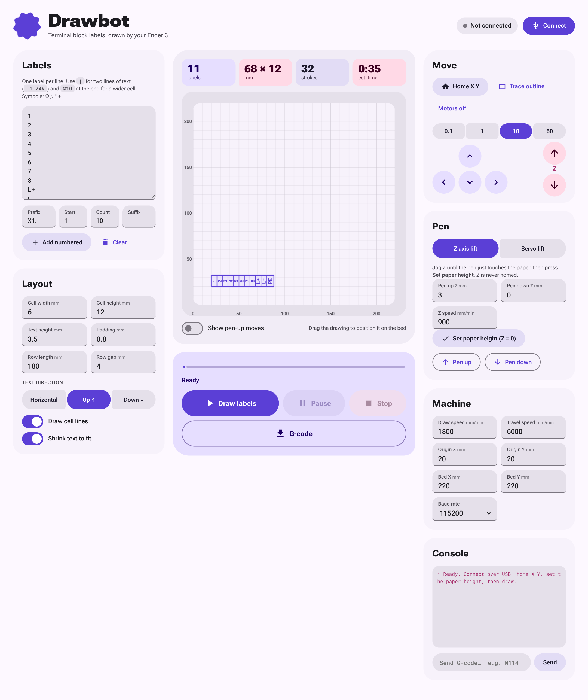
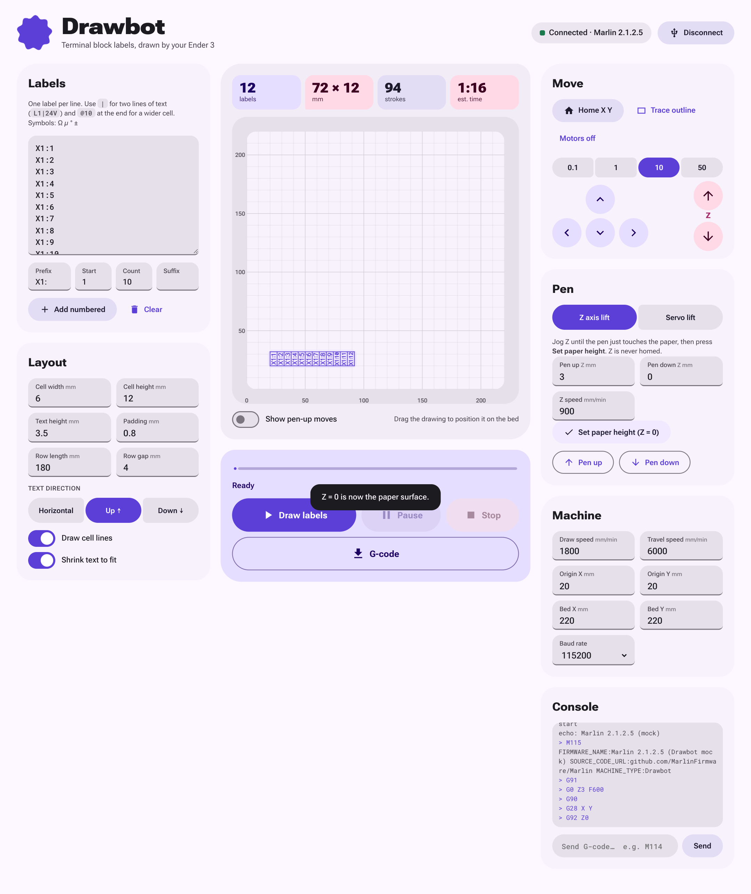
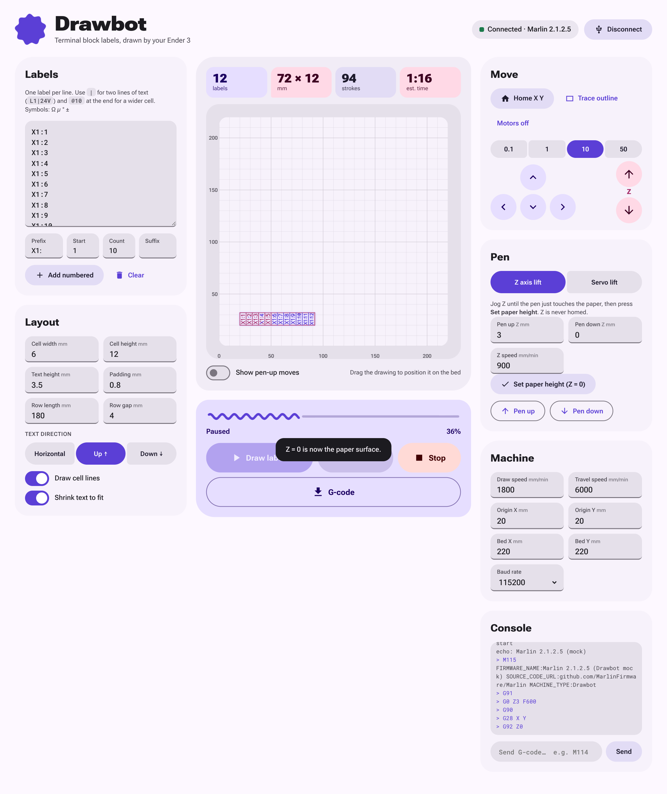
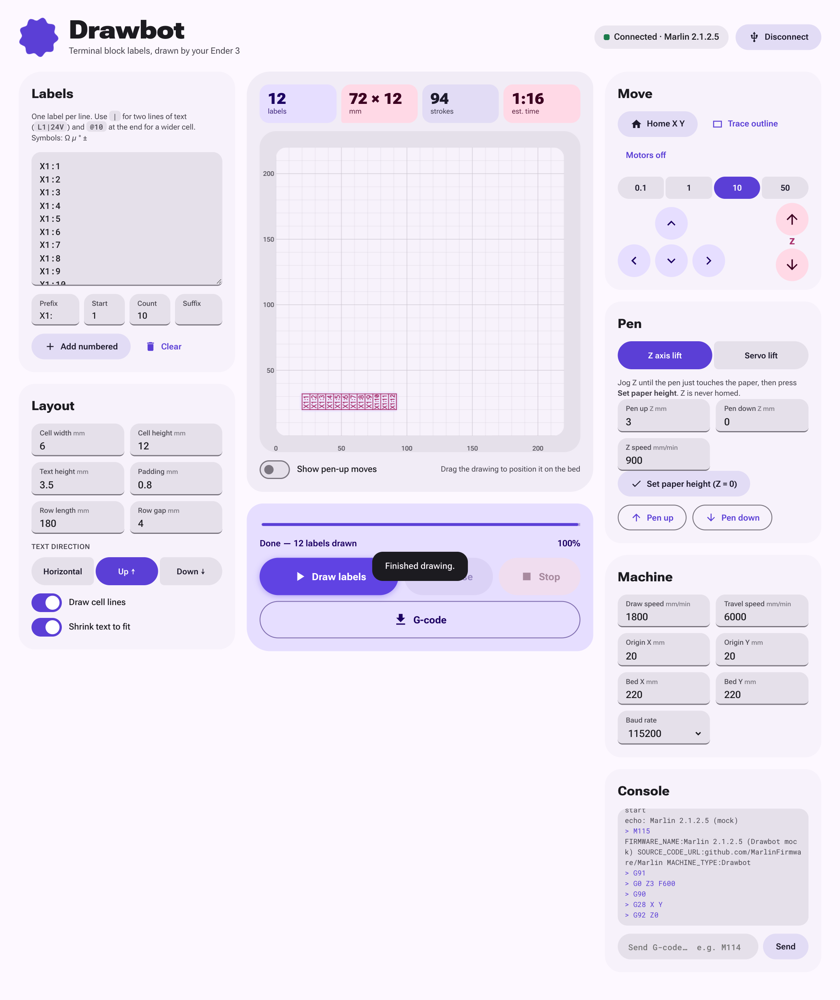
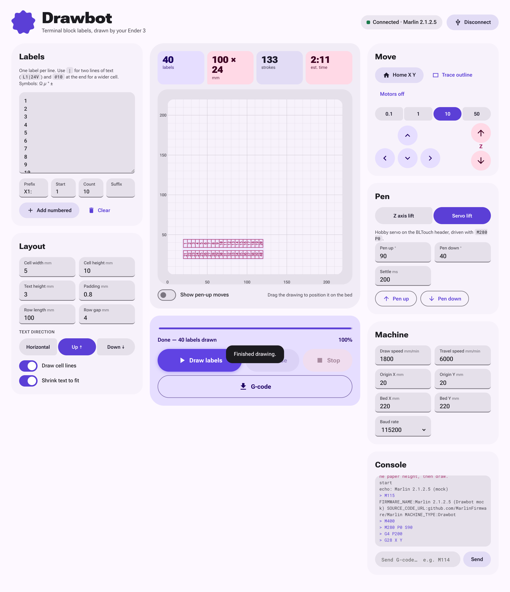
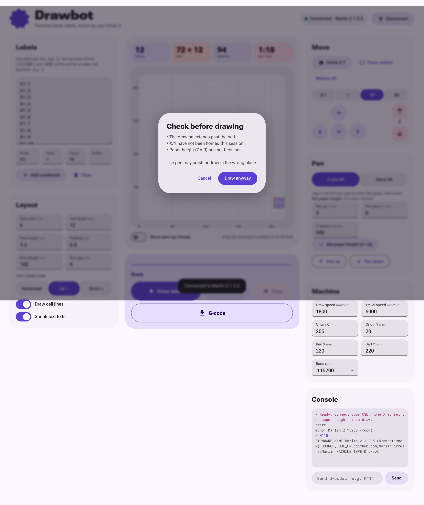
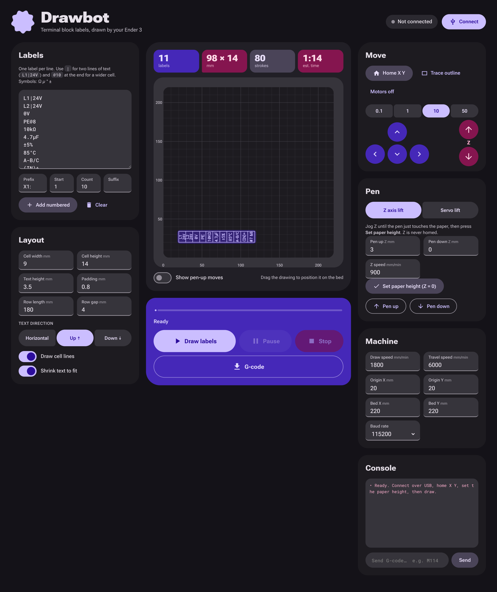
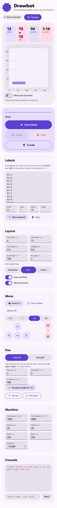

# Drawbot — Ender 3 terminal-block label plotter

```
web/        the app (Material 3 Expressive, Web Serial) — open in Chrome/Edge
firmware/   apply_drawbot.py — patches stock Marlin 2.1.x Ender-3 config for pen plotting
```

## Screenshots



| Connected & ready | Paused mid-job (35%) | Finished |
|---|---|---|
|  |  |  |

| Servo mode | Pre-flight safety dialog | Dark theme | Mobile |
|---|---|---|---|
|  |  |  |  |

## Tests

`cd tests && npm install && npm test` drives the real UI in headless Chrome against a **simulated Marlin** (`web/mock-serial.js`, also usable as a demo: open `index.html?mock`).
The simulator models Marlin's 128-byte RX buffer, `ok` replies, positions and pen state, and records every pen-down move.
Five label datasets (numbered strip, symbols + two-line labels, horizontal text, servo lift with 40 labels, single-label edge case) plus pause/resume, stop, jog and safety-dialog scenarios run end-to-end;
each dataset is checked for: all lines acknowledged, no buffer overflow, ink length and bounding box matching the design (≤0.05 mm), one pen-down per stroke, pen up and parked at the end.
Results with images of what the simulated pen drew: **[docs/TEST_RESULTS.md](docs/TEST_RESULTS.md)** (67/67 passing).
This validates the software and the G-code protocol handling, not real hardware or Marlin's actual motion.

## 1. Run the app
```
cd web && python3 -m http.server 8765      # then open http://localhost:8765
```
(`index.html` also works from `file://`.) Chrome/Edge only — Web Serial.
Plug the Ender in over USB, click **Connect**, choose the `usbserial`/`wchusbserial` port.
CH340 boards on older macOS/Windows may need the CH340 driver.

## 2. Firmware
1. Download the matching stock example from
   `MarlinFirmware/Configurations → bugfix-2.1.x → config/examples/Creality/Ender-3/`
   (`CrealityV1` = 1.1.x 8-bit board, `CrealityV422` = 4.2.x), copy `Configuration.h` and `Configuration_adv.h` into `Marlin/Marlin/`.
2. `python3 firmware/apply_drawbot.py /path/to/Marlin` (add `--no-servo` for Z-lift only). Backups are `*.orig`.
3. Build/flash with PlatformIO (VS Code). Pick the env for your board (`melzi` / `STM32F103RET6_creality`).

It turns the heaters/thermal protection off (no hotend), disables the Z-min software limit, raises Z speed
(5→20 mm/s), enables `EMERGENCY_PARSER` (instant Stop via `M410`), and enables servo 0 on the BLTouch header.
The patch script was tested against the stock V1 and V422 configs; **the firmware has not been compiled or run on hardware** — expect to check the build.
On 4.2.x boards, if compile complains about a missing sensor with `TEMP_SENSOR_0 0`, set it to `998` (dummy).

## 3. Pen mount & workflow
- **Z-axis lift (no extra hardware):** mount the pen where the nozzle was, spring-loaded if possible. Never home Z.
  Jog Z down until the tip touches the paper → **Set paper height** (`G92 Z0`). Pen-up/down moves Z by the values in the Pen card.
  Slower per stroke, so servo is better for lots of labels.
- **Servo lift:** hobby servo signal on the BLTouch header (on the 1.1.x board that is pin 27), 5 V and GND. Tune up/down angles and press the Pen up/down buttons.
- Tape the label stock down. **Home X Y**, **Trace outline** to check placement (or drag the drawing in the preview), then **Draw labels**.

## Label syntax
One label per line · `L1|24V` = two text lines · `PE@8` = 8 mm wide cell · **Add numbered** generates `X1:1…`.
Font is a built-in single-stroke font (A–Z, 0–9, `- + = . , : / ( ) % & # @ Ω µ ° ±`…). Text defaults to vertical (reads upward) so it fits narrow 5–6 mm terminals.

Stop sends `M410` and lifts the pen. Settings persist in the browser. **Not tested against a real printer** — try a dry run with the pen up first.
