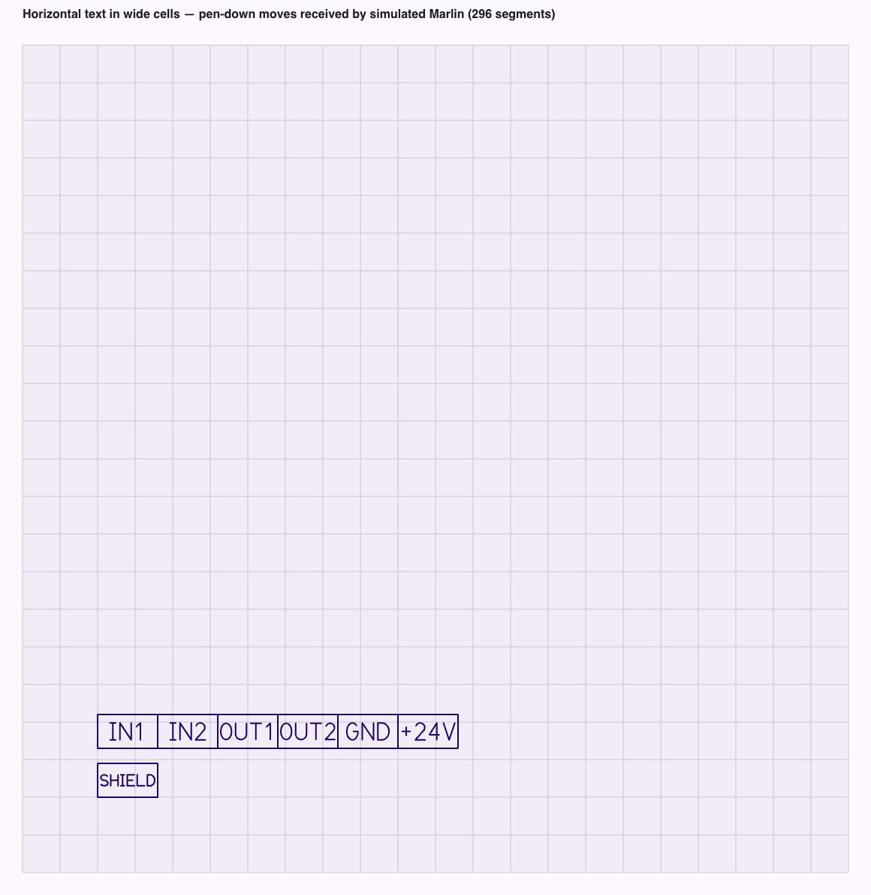

# Test results

Generated by `tests/e2e.js` (headless Chrome → real UI → simulated Marlin, `?mock` demo mode).

**67/67 checks passed.**

## UI

| | Check | Detail |
|---|---|---|
| ✅ | page loads in demo mode with no errors |  |

## Numbered strip, vertical text

| | Check | Detail |
|---|---|---|
| ✅ | layout produced every label | (12/12 labels, 94 strokes, 563 mm of ink) |
| ✅ | design fits on the bed | (72×12 mm at 20,20) |
| ✅ | connected and detected Marlin | ("Connected · Marlin 2.1.2.5") |
| ✅ | every G-code line was acknowledged | (612/612 commands in 0.1s) |
| ✅ | never overflowed Marlin's 128-byte RX buffer | (peak 74 bytes, 0 overflows) |
| ✅ | ink length matches design | (562.5 mm drawn vs 562.5 mm designed) |
| ✅ | one pen-down per stroke | (94/94) |
| ✅ | drawn bounding box lands at the origin offset | (X 20.0–92.0, Y 20.0–32.0 mm; max error 0.000 mm) |
| ✅ | pen lifted and parked at the end | (pos 0,220, pen up) |
| ✅ | no JS errors in the page |  |

## Mixed symbols and two-line labels

| | Check | Detail |
|---|---|---|
| ✅ | layout produced every label | (11/11 labels, 80 strokes, 681 mm of ink) |
| ✅ | design fits on the bed | (98×14 mm at 20,20) |
| ✅ | connected and detected Marlin | ("Connected · Marlin 2.1.2.5") |
| ✅ | every G-code line was acknowledged | (760/760 commands in 0.1s) |
| ✅ | never overflowed Marlin's 128-byte RX buffer | (peak 78 bytes, 0 overflows) |
| ✅ | ink length matches design | (681.4 mm drawn vs 681.4 mm designed) |
| ✅ | one pen-down per stroke | (80/80) |
| ✅ | drawn bounding box lands at the origin offset | (X 20.0–118.0, Y 20.0–34.0 mm; max error 0.000 mm) |
| ✅ | pen lifted and parked at the end | (pos 0,220, pen up) |
| ✅ | no JS errors in the page |  |

## Horizontal text in wide cells

| | Check | Detail |
|---|---|---|
| ✅ | layout produced every label | (7/7 labels, 52 strokes, 554 mm of ink) |
| ✅ | design fits on the bed | (96×22 mm at 20,20) |
| ✅ | connected and detected Marlin | ("Connected · Marlin 2.1.2.5") |
| ✅ | every G-code line was acknowledged | (457/457 commands in 0.1s) |
| ✅ | never overflowed Marlin's 128-byte RX buffer | (peak 78 bytes, 0 overflows) |
| ✅ | ink length matches design | (553.8 mm drawn vs 553.8 mm designed) |
| ✅ | one pen-down per stroke | (52/52) |
| ✅ | drawn bounding box lands at the origin offset | (X 20.0–116.0, Y 20.0–42.0 mm; max error 0.000 mm) |
| ✅ | pen lifted and parked at the end | (pos 0,220, pen up) |
| ✅ | no JS errors in the page |  |

## Servo pen lift, 40 labels in rows

| | Check | Detail |
|---|---|---|
| ✅ | layout produced every label | (40/40 labels, 133 strokes, 1294 mm of ink) |
| ✅ | design fits on the bed | (100×24 mm at 20,20) |
| ✅ | connected and detected Marlin | ("Connected · Marlin 2.1.2.5") |
| ✅ | every G-code line was acknowledged | (2110/2110 commands in 0.2s) |
| ✅ | never overflowed Marlin's 128-byte RX buffer | (peak 78 bytes, 0 overflows) |
| ✅ | ink length matches design | (1293.7 mm drawn vs 1293.6 mm designed) |
| ✅ | one pen-down per stroke | (133/133) |
| ✅ | drawn bounding box lands at the origin offset | (X 20.0–120.0, Y 20.0–44.0 mm; max error 0.000 mm) |
| ✅ | pen lifted and parked at the end | (pos 0,220, pen up) |
| ✅ | no JS errors in the page |  |

## Edge case: one label, no cell lines

| | Check | Detail |
|---|---|---|
| ✅ | layout produced every label | (1/1 labels, 2 strokes, 9 mm of ink) |
| ✅ | design fits on the bed | (6×12 mm at 20,20) |
| ✅ | connected and detected Marlin | ("Connected · Marlin 2.1.2.5") |
| ✅ | every G-code line was acknowledged | (14/14 commands in 0.0s) |
| ✅ | never overflowed Marlin's 128-byte RX buffer | (peak 71 bytes, 0 overflows) |
| ✅ | ink length matches design | (8.8 mm drawn vs 8.8 mm designed) |
| ✅ | one pen-down per stroke | (2/2) |
| ✅ | drawn bounding box lands at the origin offset | (X 21.3–24.8, Y 24.8–27.2 mm; max error 0.003 mm) |
| ✅ | pen lifted and parked at the end | (pos 0,220, pen up) |
| ✅ | no JS errors in the page |  |

## Pause / resume

| | Check | Detail |
|---|---|---|
| ✅ | no commands run while paused | (228 → 228) |
| ✅ | UI reports Done only after the last command executed |  |
| ✅ | job completes after resume with correct ink | (562.5 vs 562.5 mm) |

## Stop

| | Check | Detail |
|---|---|---|
| ✅ | M410 quick-stop sent |  |
| ✅ | pen lifted after stop |  |
| ✅ | queue flushed and UI reset |  |
| ✅ | nothing keeps running after stop |  |

## Manual controls

| | Check | Detail |
|---|---|---|
| ✅ | jog X+10, Y+20, X-1 from home → (9, 20) | (got 9, 20) |
| ✅ | returns to absolute mode after each jog |  |
| ✅ | Set paper height + Pen down → pen down at Z0 |  |
| ✅ | Pen up → Z lifted |  |
| ✅ | trace outline moves with pen up and returns to origin |  |
| ✅ | console command round-trips |  |
| ✅ | disconnects cleanly |  |

## Safety dialog

| | Check | Detail |
|---|---|---|
| ✅ | warns about off-bed drawing, unhomed axes and unset Z |  |
| ✅ | Cancel sends nothing |  |

