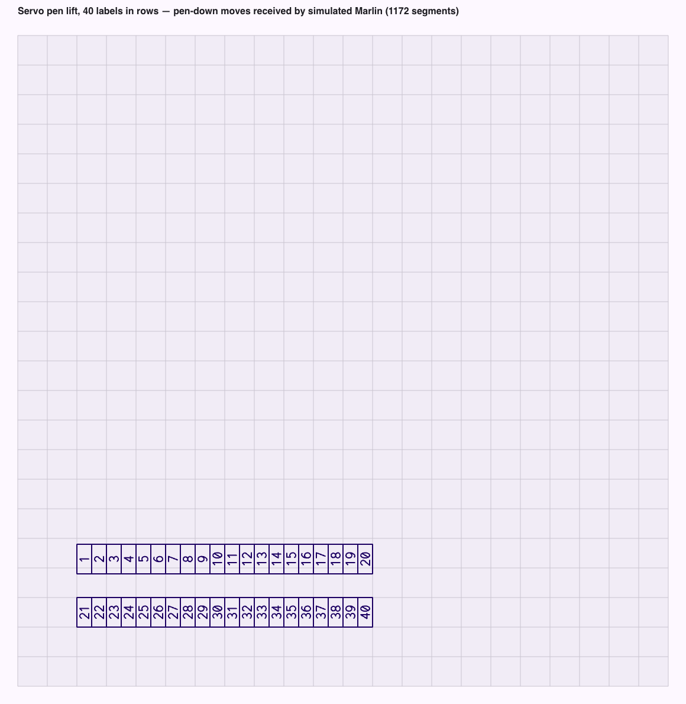

# Test results

Generated by `tests/e2e.js` (headless Chrome → real UI → simulated Marlin, `?mock` demo mode).

**80/80 checks passed.**

## UI

| | Check | Detail |
|---|---|---|
| ✅ | page loads in demo mode with no errors |  |

## Numbered marker strips, 5 mm cells

| | Check | Detail |
|---|---|---|
| ✅ | layout produced every label | (24/24 labels, 80 strokes, 584 mm of ink) |
| ✅ | design fits on the bed | (50×31 mm at 20,20) |
| ✅ | connected and detected Marlin | ("Connected · Marlin 2.1.2.5") |
| ✅ | every G-code line was acknowledged | (741/741 commands in 0.1s) |
| ✅ | never overflowed Marlin's 128-byte RX buffer | (peak 74 bytes, 0 overflows) |
| ✅ | ink length matches design | (583.6 mm drawn vs 583.5 mm designed) |
| ✅ | one pen-down per stroke | (80/80) |
| ✅ | drawn bounding box lands at the origin offset | (X 20.0–70.0, Y 20.0–51.0 mm; max error 0.000 mm) |
| ✅ | pen lifted and parked at the zero point | (pos 0,0, pen up) |
| ✅ | no JS errors in the page |  |

## Mixed symbols and two-line labels

| | Check | Detail |
|---|---|---|
| ✅ | layout produced every label | (11/11 labels, 86 strokes, 709 mm of ink) |
| ✅ | design fits on the bed | (45×58 mm at 20,20) |
| ✅ | connected and detected Marlin | ("Connected · Marlin 2.1.2.5") |
| ✅ | every G-code line was acknowledged | (784/784 commands in 0.1s) |
| ✅ | never overflowed Marlin's 128-byte RX buffer | (peak 74 bytes, 0 overflows) |
| ✅ | ink length matches design | (709.3 mm drawn vs 709.4 mm designed) |
| ✅ | one pen-down per stroke | (86/86) |
| ✅ | drawn bounding box lands at the origin offset | (X 20.0–65.0, Y 20.0–78.0 mm; max error 0.000 mm) |
| ✅ | pen lifted and parked at the zero point | (pos 0,0, pen up) |
| ✅ | no JS errors in the page |  |

## Horizontal text in wide cells

| | Check | Detail |
|---|---|---|
| ✅ | layout produced every label | (7/7 labels, 52 strokes, 554 mm of ink) |
| ✅ | design fits on the bed | (96×26 mm at 20,20) |
| ✅ | connected and detected Marlin | ("Connected · Marlin 2.1.2.5") |
| ✅ | every G-code line was acknowledged | (457/457 commands in 0.1s) |
| ✅ | never overflowed Marlin's 128-byte RX buffer | (peak 78 bytes, 0 overflows) |
| ✅ | ink length matches design | (553.8 mm drawn vs 553.8 mm designed) |
| ✅ | one pen-down per stroke | (52/52) |
| ✅ | drawn bounding box lands at the origin offset | (X 20.0–116.0, Y 20.0–46.0 mm; max error 0.000 mm) |
| ✅ | pen lifted and parked at the zero point | (pos 0,0, pen up) |
| ✅ | no JS errors in the page |  |

## Servo pen lift, 40 labels in rows

| | Check | Detail |
|---|---|---|
| ✅ | layout produced every label | (40/40 labels, 133 strokes, 1294 mm of ink) |
| ✅ | design fits on the bed | (100×28 mm at 20,20) |
| ✅ | connected and detected Marlin | ("Connected · Marlin 2.1.2.5") |
| ✅ | every G-code line was acknowledged | (2110/2110 commands in 0.3s) |
| ✅ | never overflowed Marlin's 128-byte RX buffer | (peak 78 bytes, 0 overflows) |
| ✅ | ink length matches design | (1293.7 mm drawn vs 1293.6 mm designed) |
| ✅ | one pen-down per stroke | (133/133) |
| ✅ | drawn bounding box lands at the origin offset | (X 20.0–120.0, Y 20.0–48.0 mm; max error 0.000 mm) |
| ✅ | pen lifted and parked at the zero point | (pos 0,0, pen up) |
| ✅ | no JS errors in the page |  |

## Edge case: one label, no cell lines

| | Check | Detail |
|---|---|---|
| ✅ | layout produced every label | (1/1 labels, 2 strokes, 9 mm of ink) |
| ✅ | design fits on the bed | (5×5 mm at 20,20) |
| ✅ | connected and detected Marlin | ("Connected · Marlin 2.1.2.5") |
| ✅ | every G-code line was acknowledged | (14/14 commands in 0.0s) |
| ✅ | never overflowed Marlin's 128-byte RX buffer | (peak 70 bytes, 0 overflows) |
| ✅ | ink length matches design | (8.5 mm drawn vs 8.5 mm designed) |
| ✅ | one pen-down per stroke | (2/2) |
| ✅ | drawn bounding box lands at the origin offset | (X 20.8–24.2, Y 21.4–23.6 mm; max error 0.003 mm) |
| ✅ | pen lifted and parked at the zero point | (pos 0,0, pen up) |
| ✅ | no JS errors in the page |  |

## Pause / resume

| | Check | Detail |
|---|---|---|
| ✅ | no commands run while paused | (273 → 273) |
| ✅ | UI reports Done only after the last command executed |  |
| ✅ | job completes after resume with correct ink | (583.6 vs 583.5 mm) |

## Stop

| | Check | Detail |
|---|---|---|
| ✅ | M410 quick-stop sent |  |
| ✅ | pen lifted after stop |  |
| ✅ | queue flushed and UI reset |  |
| ✅ | nothing keeps running after stop |  |

## Manual controls

| | Check | Detail |
|---|---|---|
| ✅ | jog X+10, Y+20, X-1 from home → (9, 20) | (got 9, 20) |
| ✅ | returns to absolute mode after each jog |  |
| ✅ | Set paper height + Pen down → pen down at Z0 |  |
| ✅ | Pen up → Z lifted |  |
| ✅ | trace outline moves with pen up and returns to origin |  |
| ✅ | console command round-trips |  |
| ✅ | disconnects cleanly |  |

## Safety dialog

| | Check | Detail |
|---|---|---|
| ✅ | warns about off-bed drawing and unset zero |  |
| ✅ | Cancel sends nothing |  |

## Zero point

| | Check | Detail |
|---|---|---|
| ✅ | Set 0 XYZ sends G92 and is not G28 |  |
| ✅ | top-right anchor shifts the drawing so that corner sits at the offset | G1 X25 Y10 F1800 -> G1 X10 Y5 F1800 |

## Toolpath

| | Check | Detail |
|---|---|---|
| ✅ | safe job reports no problems | ✓ All 725 moves stay on the bed, above the paper and on the  |
| ✅ | zero near the bed edge flags moves outside the bed | ✗ Moves outside the bed (220 × 220 mm) (579 moves) — first at X40.0 Y20.0 |
| ✅ | negative pen-down Z is flagged as below the paper |  |
| ✅ | back to safe values clears the problems |  |
| ✅ | top-right anchor with small offset leaves the bed (negative X/Y relative to zero is fine, bed edge is not) |  |

## Firmware

| | Check | Detail |
|---|---|---|
| ✅ | builds a patched zip from the current Marlin config on GitHub | {"sig":"80,75,3,4","size":373440,"miss":0,"name":"drawbot-firmware-CrealityV422-servo.zip"} |

## Card types

| | Check | Detail |
|---|---|---|
| ✅ | Phoenix ZB 5 preset sets 5.2 x 10.5 mm cells, 52 mm row | 5.2,10.5,52 |
| ✅ | Weidmuller DEK 5 FW preset sets 5 x 5 mm cells, 50 mm row | 5,5,50 |
| ✅ | all variants listed |  |

## Preview

| | Check | Detail |
|---|---|---|
| ✅ | button animates then skips to end | Skip to end / Replay moves |
| ✅ | preview sends nothing to the printer |  |

